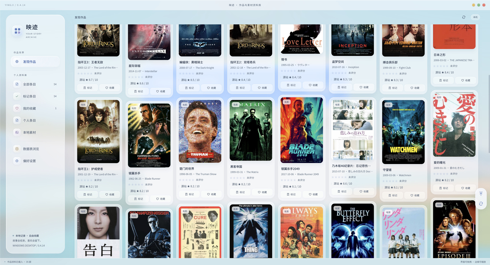
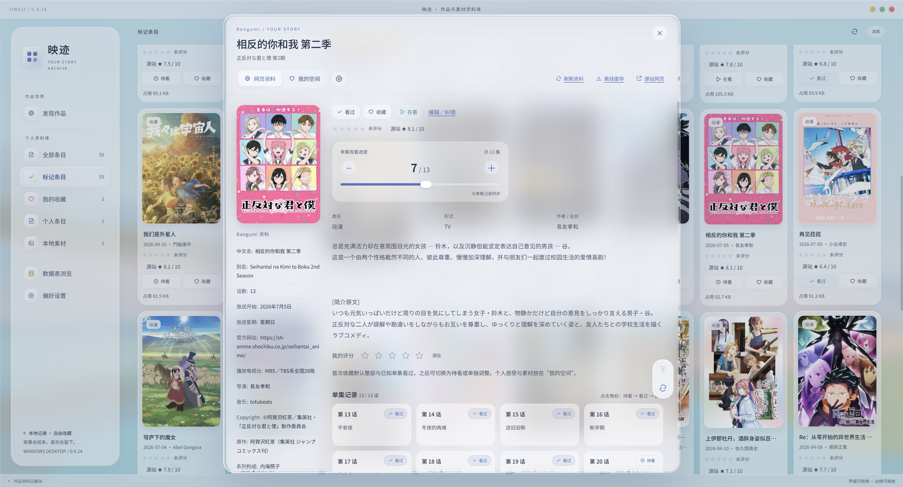
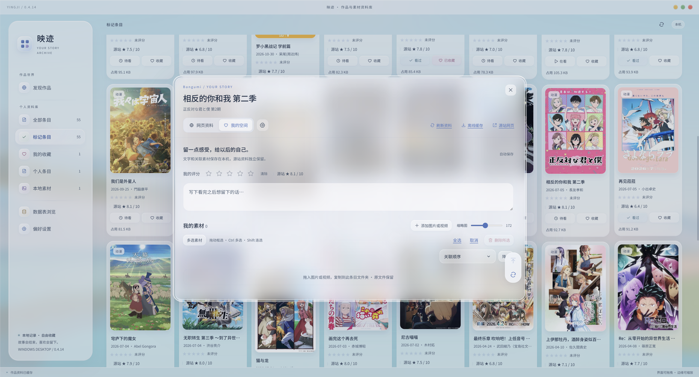

# 映迹资料库

Windows 桌面作品与素材资料库。按年份探索作品，记录看过、待看、在看与收藏，并保存个人评分、观后感和图片、视频素材。

当前源码版本：**0.4.15**。

[下载最新版程序](https://github.com/LemonTeaBoxL/yingji-library/releases/tag/v0.4.15) · [全部发行版本](https://github.com/LemonTeaBoxL/yingji-library/releases)

## 界面预览



| 作品详情与单集进度 | 我的空间与素材 |
| --- | --- |
|  |  |

截图拍摄于 0.4.14。当前版本的分类与新功能以更新说明为准。[查看完整 7 张界面截图](docs/screenshots/README.md)。

## 使用

从本仓库的 Releases 下载最新版 Windows x64 便携程序，退出旧版后双击运行。个人资料保存在用户选择的文件夹，升级程序保留资料。

- Bangumi 动画、影视、游戏、书籍和音乐资料浏览，提供年份、季度、地区、形式、评分筛选与源网页排序。
- 个人库连续瀑布流、列表与封面显示，支持搜索、筛选、排序和多选。
- 作品与单集评分、评论和观看进度；作品网页资料与“我的空间”独立呈现。
- 图片、视频拖入后复制到资料库；支持素材预览、框选、多选和视频截帧、裁切。
- 可迁移的 UTF-8 JSON 索引和独立条目文件夹；支持导入、导出及手动 WebDAV 快照同步。
- 多主题、缩放与玻璃外观。桌面磨砂由 Windows 提供，应用内折射处理应用内背景。
- 可选 Chrome 扩展同步所选 Bangumi 网站的登录会话；AI 本机接口当前只读。

详细行为、删除说明和版本变更见 [使用说明](使用说明.txt)。

## 开发

在 Windows 上安装 Node.js 24，然后在项目目录运行：

```powershell
npm ci
npm start
```

语法与功能检查：

```powershell
npm run check
```

生成 Windows 便携程序：

```powershell
npm run package
```

发行包生成在 `releases`。`dist` 同时包含实际界面源码和本地资源，需要纳入版本管理。

视频处理与自包含发行包需要 `tools/ffmpeg.exe`、`tools/ffprobe.exe`。工具版本、来源及许可证见 [tools/README.txt](tools/README.txt)；将对应 Windows 可执行文件放入 `tools` 后再打包。开发时程序也可调用系统 PATH 中的 FFmpeg。第三方声明见 [THIRD_PARTY_NOTICES.txt](THIRD_PARTY_NOTICES.txt)。

## 项目结构

| 位置 | 内容 |
|---|---|
| `main.cjs`、`preload.cjs` | 桌面入口与界面通信 |
| `dist` | 界面逻辑、样式、字体、演示素材 |
| `lib` | 作品来源、资料存储、缓存、导入与同步 |
| `src` | 玻璃适配与光学层源码 |
| `browser-extension` | 用户主动操作的 Bangumi 登录同步扩展 |
| `tests` | 功能测试 |
| `docs` | 工程约定与验证摘要 |
| `历史版本` | 本机旧版文件及归档目录清单 |

定位功能请先读 [PROJECT_INDEX.md](PROJECT_INDEX.md)，避免重复读取整份实现历史。临时测试目录、依赖、用户资料和程序二进制不提交到 Git；最新版程序通过 Release 附件保存。

仓库与后续发布方式见 [GitHub 说明](docs/GITHUB.md)。
