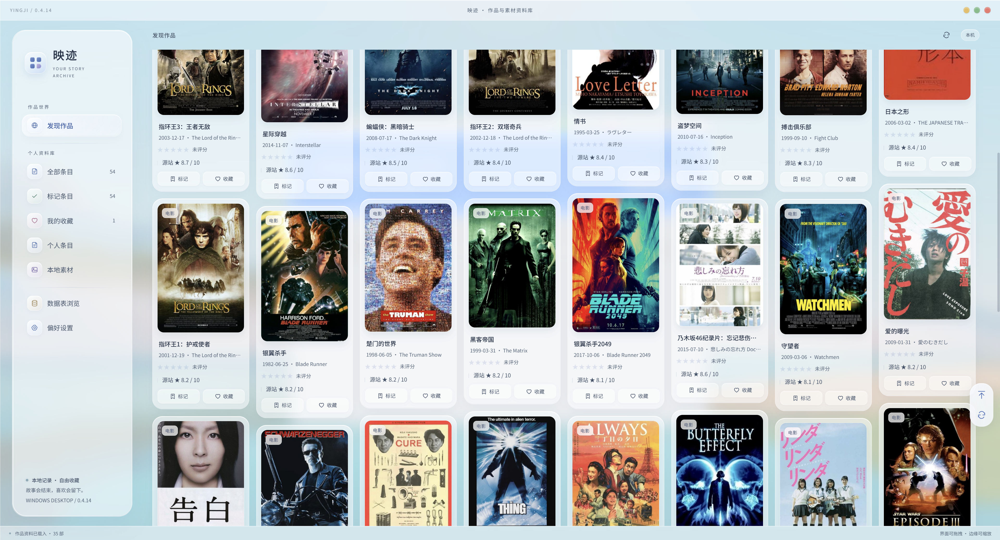
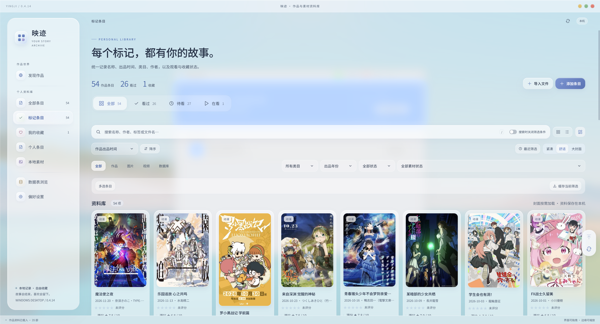
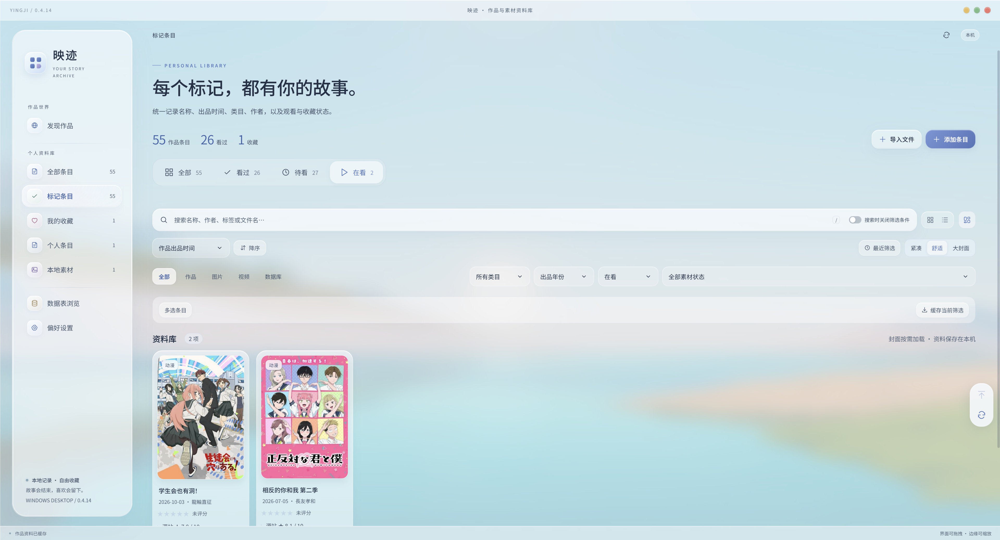
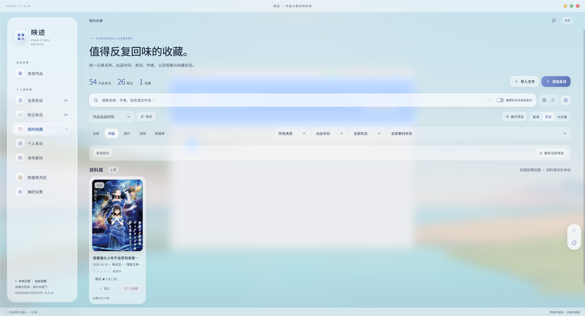
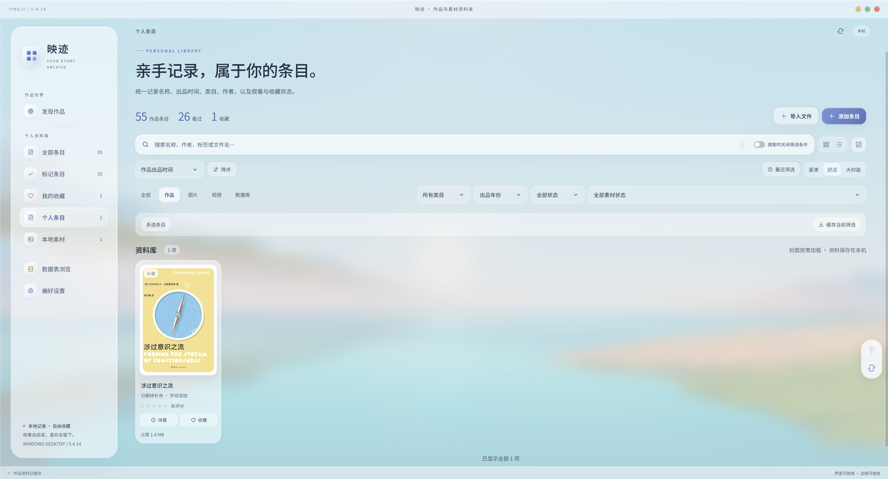
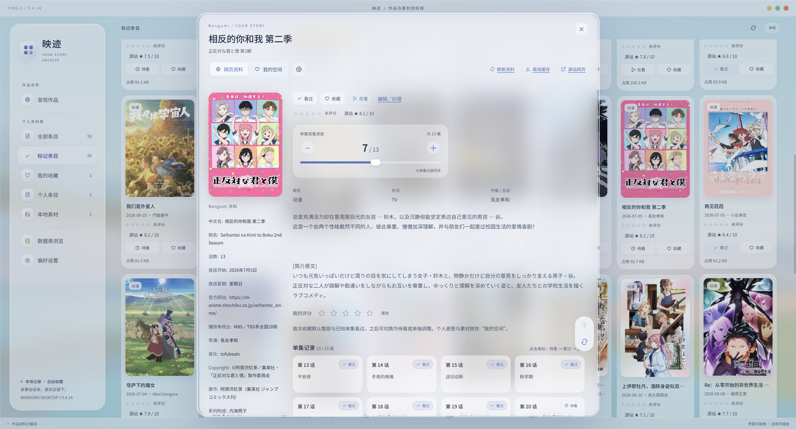
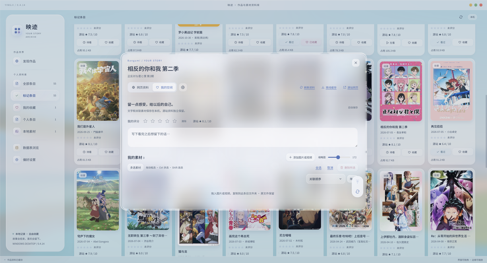

# 界面图库

以下 7 张原图由用户提供，拍摄于 0.4.14。当前版本为 0.4.15，“小说”已统一为“书籍”，并新增书籍、音乐数据源及个人封面右键设置；新功能以[更新说明](../../使用说明.txt)为准。

[返回项目首页](../../README.md)

## 发现作品与瀑布流

浏览电影等作品的封面瀑布流，直接标记或收藏到个人资料库。

## 个人资料库

用连续瀑布流浏览已标记作品，按观看状态及作品信息筛选。

## 在看与状态筛选

在标记条目中切换全部、看过、待看和在看，结合搜索、排序及素材条件查找记录。

## 我的收藏

集中查看收藏作品，同时显示源站评分、个人记录和条目占用空间。

## 自建个人条目

保存手动创建的作品与自定义分类，独立记录评分、状态、封面和关联素材。

## 作品详情与单集进度

查看源站信息和主创资料，拖动单集观看进度，并与单集记录同步。

## 我的空间

保存个人评分、观后感和图片、视频素材，支持缩略图调整与素材多选。

